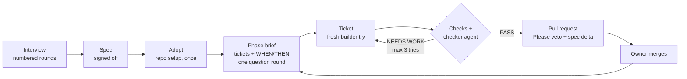

# Cadence Works Claude workflow

A Claude plugin marketplace with one plugin, **`spec-driven`**: the way of working first used on
FareSlip, packaged so any project, in any Claude account, works the same way.



## The rules in one screen

| Rule                       | What it means                                                                                         |
| -------------------------- | ----------------------------------------------------------------------------------------------------- |
| Interview before spec      | Numbered questions, each with a suggested answer; assumptions are confirmed, never guessed            |
| Signed-off spec            | Nothing is built before the owner writes "signed off"; the spec ends with a numbered confirm list     |
| One brief per phase        | Tickets, dependencies and WHEN/THEN criteria in `docs/phases/`; no separate ticket files              |
| One question round         | All open questions of a phase in one numbered list; answers go to `docs/decisions.md`                 |
| Default and record         | Choices that can be undone are decided, recorded and listed under "Please veto" in the pull request   |
| Stop and ask               | Only for the project's list: production, real data, signed-off behaviour, money, security, ...        |
| FAIL first                 | Every criterion is FAIL until a test or command that was run proves it                                |
| Fresh checker              | A separate agent with no edit rights judges every ticket; the builder never grades its own work       |
| Up to 3 tries              | Findings start a new fresh builder on the same branch; after 3 failures, draft PR and report          |
| Spec deltas                | Signed-off behaviour changes only as ADDED / CHANGED / REMOVED with the owner's yes                   |
| Never merge, never deploy  | The owner merges; production only through the release path the owner controls                        |
| Guard rails                | Deny rules for deploys and secret files, path rules per area, format-on-edit hook, CI checks          |

## What is in the plugin

| Part                 | Name                          | Use                                                                    |
| -------------------- | ----------------------------- | ---------------------------------------------------------------------- |
| Skill                | `/spec-driven:interview`      | Structured interview before a spec                                     |
| Skill                | `/spec-driven:spec`           | Spec for sign-off, and spec deltas afterwards                          |
| Skill                | `/spec-driven:adopt`          | Set up a repository: CLAUDE.md, docs, rules, deny rules, PR template   |
| Skill                | `/spec-driven:brief`          | Plan one phase                                                         |
| Skill                | `/spec-driven:ticket`         | Build one ticket in fresh tries until the checker passes it            |
| Skill                | `/spec-driven:verify`         | Prove every criterion before "done"                                    |
| Agent                | `spec-driven:checker`         | Independent judge of a ticket (read and run only)                      |
| Agent                | `spec-driven:access-reviewer` | Authorization and data-isolation review                                |
| Hook                 | format on edit                | Runs the project's own formatter (Prettier, Ruff, gofmt, rustfmt, terraform fmt) |
| Templates            | `templates/`                  | CLAUDE.md, spec, phase brief, decisions, rules, settings, PR template, **project instructions** |
| Examples (optional)  | `examples/fareslip/`          | Real rules for Expo, AWS/Terraform and a multi-tenant API              |

## Setup

### 1. Install the plugin on your Claude account (once per account)

This is the route that reaches every Claude surface: chat, Cowork, Claude desktop projects and
Claude Code.

1. Open [**Customize > Plugins**](https://claude.ai/customize/plugins) in claude.ai or the Claude
   desktop app, signed in with the account you will work with (your work account for company
   projects).
2. **Add > Add marketplace**, enter `cadenceworks-dev/claude-workflow`.
3. Open **spec-driven** and select **Add**. Turn on **Sync automatically** to get updates.

The repository is public, so no GitHub connection is needed on the work side.

**Company account (Team or Enterprise plan).** An Owner of your company's Claude organization
decides whether members can add their own marketplaces. If **Add marketplace** is missing or
refused, ask the Owner to do one of these:

- add the marketplace for the whole organization under
  [Organization settings > Plugins & skills](https://claude.ai/admin-settings/skills?tab=marketplaces)
  (they can also make the plugin "installed by default" for everyone); or
- if they keep an allowlist of plugin sources (`strictKnownMarketplaces` in Claude Code managed
  settings), add this entry:

  ```json
  { "source": "github", "repo": "cadenceworks-dev/claude-workflow" }
  ```

If plugins are switched off altogether, use the vendored copy (step 3, last point).

### 2. Create the Claude project

1. Create the project in the Claude desktop app and attach the repository (or none yet, for a
   brand-new product).
2. Paste [`project-instructions.md`](plugins/spec-driven/templates/project-instructions.md) into
   the project's instructions and fill in the `<...>` parts (owner, stop-and-ask list, release
   path).
3. Start with: _"Interview me about `<product>`."_ Then _"Write the spec"_, and after sign-off
   _"Adopt the workflow in the repository"_ and _"Brief phase 0"_.

### 3. Per repository (done for you by `/spec-driven:adopt`)

- `CLAUDE.md` gets "Validation", "How we work" and "Rules".
- `docs/` gets `README.md`, `decisions.md` and `phases/TEMPLATE.md`.
- `.claude/rules/<area>.md` per area; `.claude/settings.json` with allow and deny rules, plus the
  plugin listed for local Claude Code sessions.
- `.github/pull_request_template.md` with the criteria table, "Please veto" and "Spec delta".
- **Vendored copy, when plugins cannot be used:** ask `/spec-driven:adopt` to vendor the plugin.
  It copies the skills, agents and hook into the repository's `.claude/`, which every Claude Code
  session reads, cloud sessions included. FareSlip works this way today.

### Claude Code on a computer (optional)

Plugins on your Claude account also sync to Claude Code in the terminal and the desktop **Code**
tab. Without an account sync (API key, `CLAUDE_CODE_DISABLE_NONESSENTIAL_TRAFFIC`), install from
the command line:

```bash
claude plugin marketplace add cadenceworks-dev/claude-workflow
claude plugin install spec-driven@cadenceworks
```

## Updating the plugin

Change files under `plugins/spec-driven/`, raise `version` in both
`plugins/spec-driven/.claude-plugin/plugin.json` and `.claude-plugin/marketplace.json`, and merge.
Accounts with **Sync automatically** pick it up; on the command line run
`claude plugin update spec-driven@cadenceworks`. Check with `claude plugin validate .` before
pushing (CI does the same).
