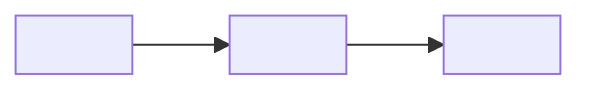
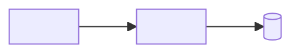

# <Product> specification

Status: draft | signed off <date> by <Owner>. Changes after sign-off: see "Spec deltas" in
`docs/decisions.md`.

## 1. Goal

<The problem, who has it, and what success looks like, in three to five sentences.>

## 2. Users and roles

| Role | Can | Cannot |
| ---- | --- | ------ |

## 3. Main flows

<One short subsection per flow. Rules as testable statements.>

## 4. Business rules

1. <Rule, with numbers and limits.> (source: <interview P2.3 / document>)

## 5. Data

<What is stored, who owns it, retention, privacy, imports and exports.>

## 6. Platforms and user experience

<Web, phone, offline, languages, accessibility, brand.>

## 7. Integrations

## 8. Architecture

<Hosting, environments (dev, prod), domains, how a change reaches production and who releases.>

## 9. Security

<Sign-in, authorization on every call, secrets, logging rules, scanning.>

## 10. Phases

| Phase | Delivers | Waits on |
| ----- | -------- | -------- |
| 0     | Foundations: repository, CI, environments, deploy, empty apps | |
| 1     | <thin slice a user can try> | |

## 11. Out of scope for now

## 12. Blocked

- <Rule> waits on <who>.

## 13. Confirm or correct

Reply with the numbers you disagree with; everything else counts as confirmed.

1. <Assumption or open question>. Suggested: <answer>.
